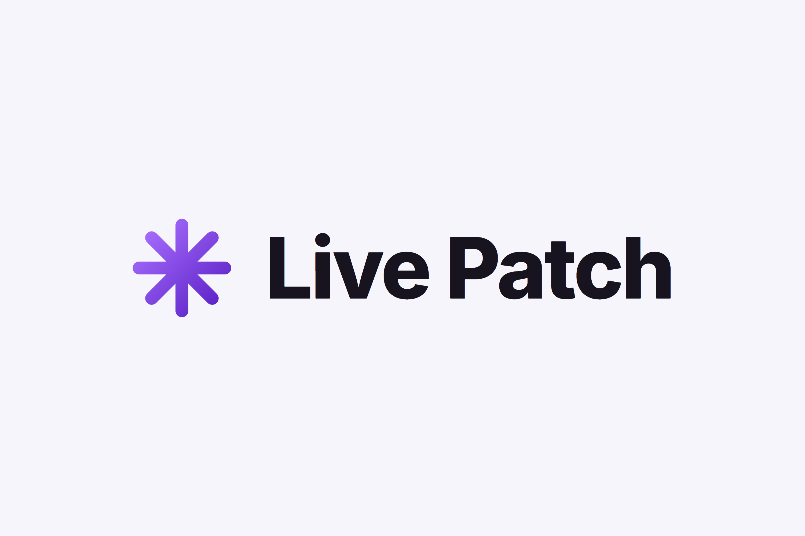
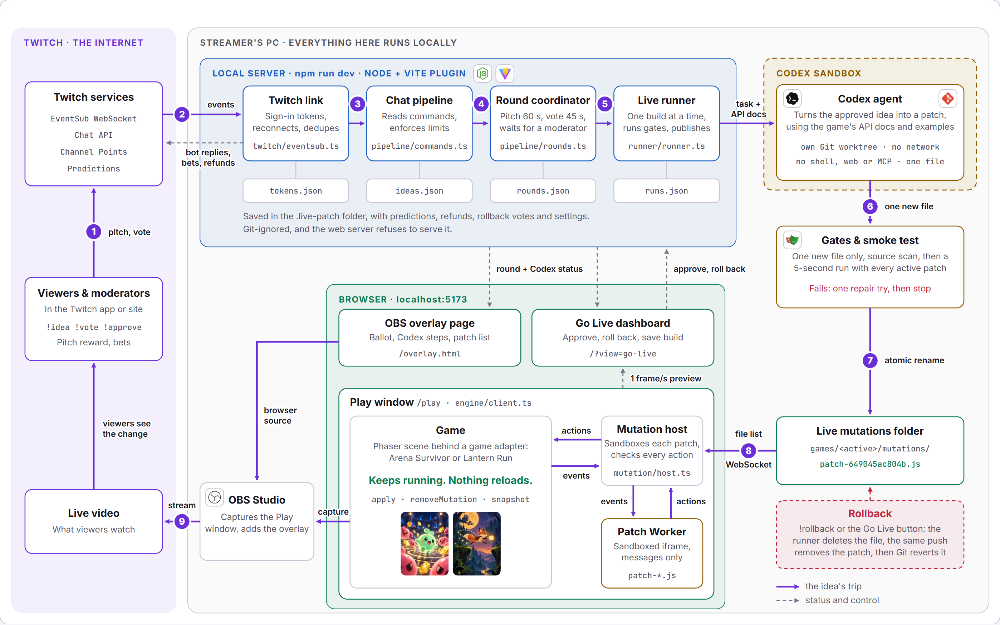
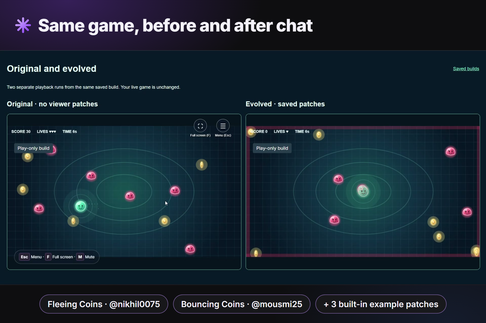
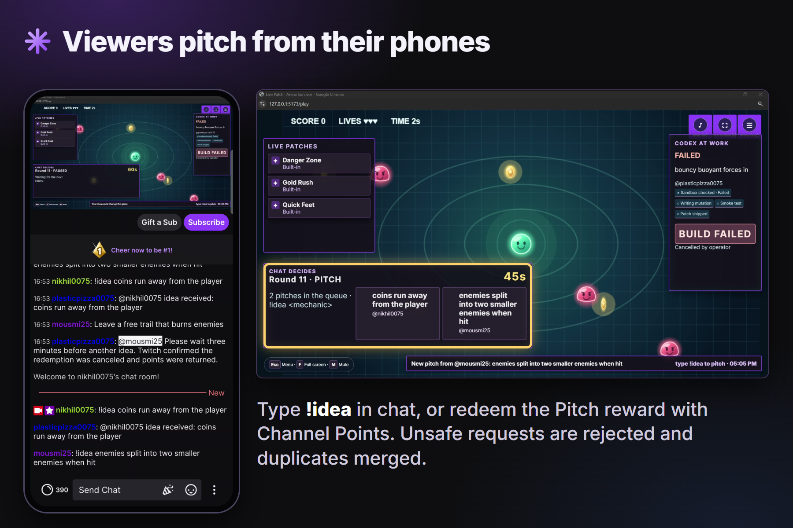
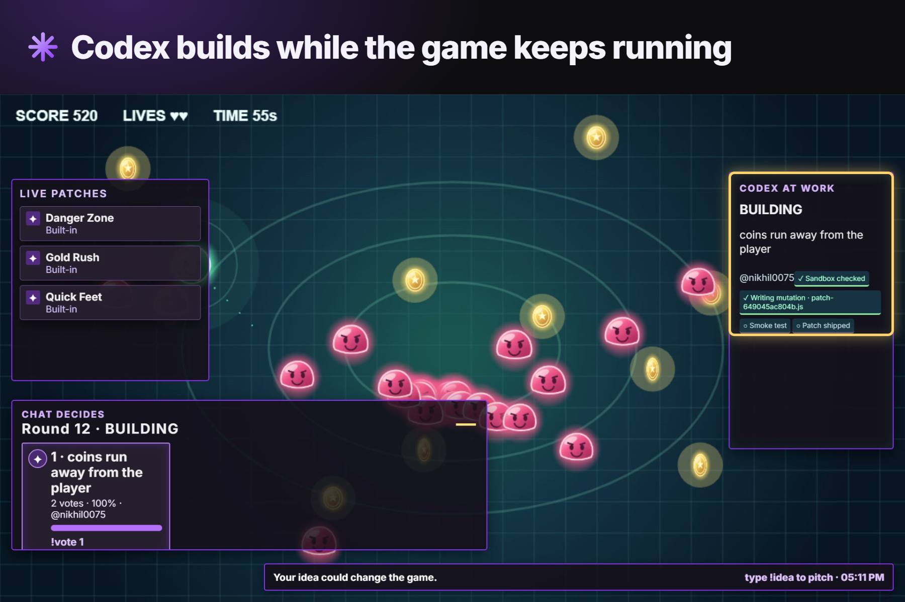
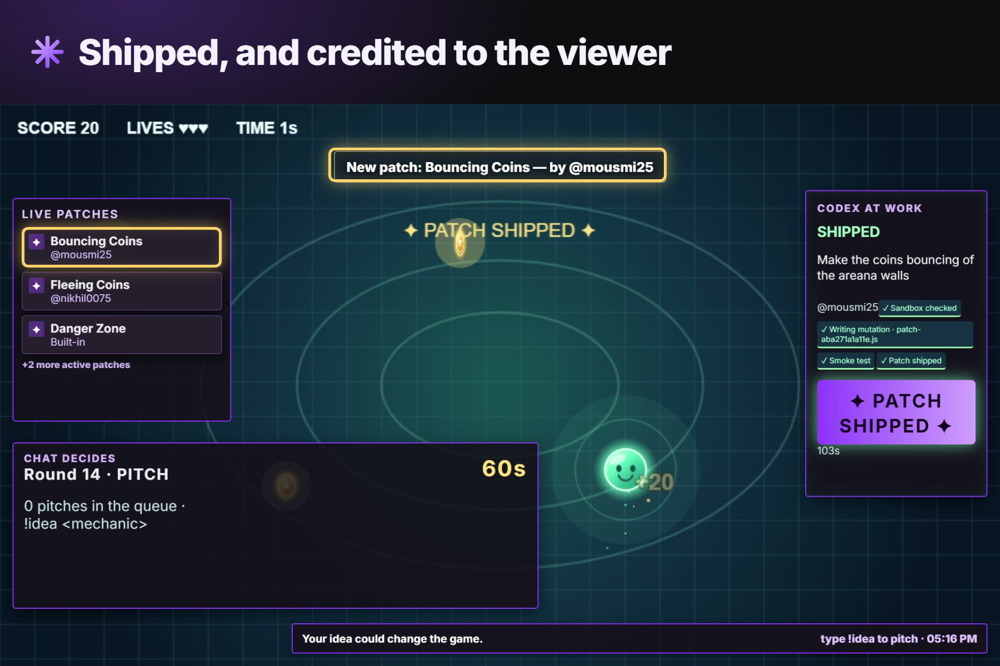
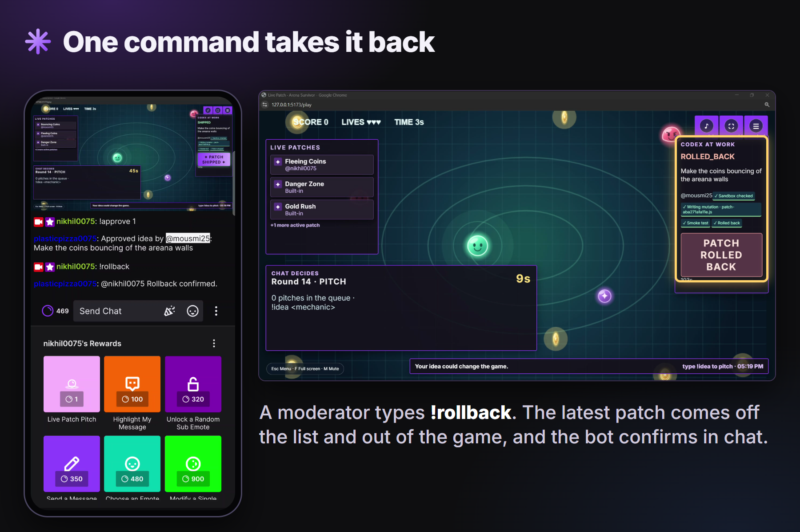
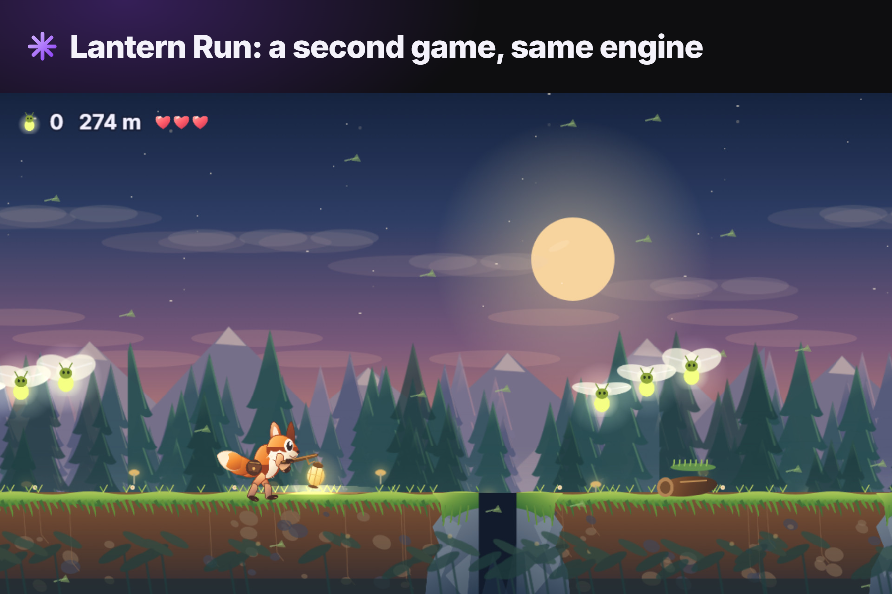

# Live Patch

**A Twitch stream where chat changes the game while you play.** Viewers pitch mechanics, vote on a winner, and watch Codex build and test the approved idea. Passing patches appear in the live game without restarting the run; every shipped idea credits its contributors.

<p align="center">
  <picture>
    <source media="(prefers-color-scheme: dark)" srcset="docs/media/logo/live-patch-logo-3x2-dark.png">
    
  </picture>
</p>

<p align="center">
  
  
</p>
<p align="center"><strong>Arena Survivor</strong> · <strong>Lantern Run</strong> · One manifest-driven studio</p>

| Try it locally | Take it on stream | Keep what chat made |
|---|---|---|
| Practice runs a sample pitch and vote without accounts. | Connect Twitch and Codex, then show the game and OBS overlay. | Save playable builds, credited patch notes, and an original-versus-evolved comparison. |

**[Get started](#quick-start)** · **[Gallery](#gallery)** · **[How it works](#how-it-works)** · **[Stream setup](#twitch-and-stream-setup)** · **[Commands](#commands)** · **[Architecture](docs/architecture.md)** · **[Add a game](docs/adding-a-game.md)**

Watch the [2:21 demo video](https://youtu.be/zuyCcjgMr1Y?si=40spIwIUN5jMJtv6). The [three-minute demo outline](docs/demo-script.md) covers the product tour.

## How it works

<a href="docs/architecture.md"><picture><source media="(prefers-color-scheme: dark)" srcset="docs/media/architecture/01-system-loop-dark.png"></picture></a>

1. Viewers pitch mechanics in chat or with a Channel Points reward. Practice uses simulated viewers in the same pipeline.
2. The three oldest ideas enter a 45-second vote after a 60-second pitch window. Each viewer gets one vote.
3. A moderator or the broadcaster approves the winner. Approval has no timer.
4. Codex builds the patch in its own worktree. Source gates and a smoke test check it alongside active patches.
5. A passing patch loads into the running game.
6. Viewers see the change and its credit on stream.

## Gallery

| | | |
|---|---|---|
| [](docs/gallery.md)<br>Same game, before and after chat | [](docs/gallery.md)<br>Viewers pitch from their phones | [](docs/gallery.md)<br>Codex builds while the game keeps running |
| [](docs/gallery.md)<br>Shipped, and credited to the viewer | [](docs/gallery.md)<br>One command takes it back | [](docs/gallery.md)<br>Lantern Run: a second game, same engine |

[See all 15 gallery images](docs/gallery.md).

## Safety

- Codex builds each approved patch in an isolated Git worktree without network, shell, web search, apps, plugins or MCP access. It may add one file in the active game's mutation folder, up to 120 lines and 12 KB. Source gates and a five-second smoke test with all active patches run before shipping.
- A patch runs in a Worker inside a sandboxed iframe. The host limits it to 20 actions per event batch and 60 per second. It has a 3 s load deadline and a 1.8 to 2.2 s event deadline. A rule-breaking or late patch is switched off while play continues. A moderator's `!rollback` removes the latest patch at once.
- Viewer text is inserted as text, never as HTML. A rejected build gate or smoke test resolves a prediction as **Fails**; sandbox, quota, timeout, cancellation and restart cancel it so Twitch returns points. [Read the architecture](docs/architecture.md).

## Quick start

Use Windows 10 or 11, Node.js 20 or newer, and Git. The game and Practice work without Twitch credentials or a Codex account. Live AI patch building additionally needs a local Codex/ChatGPT sign-in and the Windows elevated Codex sandbox. Twitch chat, rewards and predictions require a Twitch developer app and eligible channel features.

```sh
git clone https://github.com/Nikhil0075/live-patch.git
cd live-patch
npm run setup
npm run dev
```

Open **https://localhost:5173**. The local HTTPS certificate is self-signed; accept the browser warning once. The first visit shows a welcome choice. Click **Try it now** for a two-minute rehearsal without accounts. Setup remains available from the sidebar when you want Twitch, Codex and OBS. `npm run setup` installs missing packages and Chromium, then checks local prerequisites. It does not configure Windows security or connect Twitch accounts for you.

### What to see in two minutes

1. Click **Try it now** on the welcome, then **Run a full round automatically** in Practice. Sample viewers pitch and vote through the real local pipeline. The round reaches approval without typing.
2. Click **Ship a demo patch**. It scatters a visible coin shower around the player and says which Practice idea it stands in for; the idea is recorded as a demo, not a shipped viewer mechanic. Practice sends nothing to Twitch. Remove demo patches in Go Live before connecting a live round. To build a new patch instead, complete **Setup → Codex sign-in** and **Sandbox**, then approve a pitch.
3. Click **Play in new window** from Home or Library. Play requests a separate 1280 × 720 popup; repeated clicks reuse that window. Allow popups for the local studio if your browser blocks it. Move with WASD or arrows and attack with Space. Press **Esc** or **P** for the pause menu, **F** for full screen and **M** to mute. Resume has focus when the menu opens. In browsers that reserve Esc for leaving full screen, use P for the menu.
4. Use the top-bar **Practice / Live** links to move between rehearsal and stream controls. Open **Go Live** to see the real Play window mirrored beneath the OBS overlay. Use the ballot, chat, quick actions and Codex timeline. Try the **Default** and **Chat focus** layouts; collapsed panels and order are saved in this browser. In **OBS overlay layout**, add or remove widgets, drag them or their corners to move and resize, or enter exact coordinates. Changes persist and appear in OBS automatically.

The game-agnostic engine reads the active game's `live-patch.json`. Two games ship: **Arena Survivor**, a WASD and Space survival arena, remains the default; **Lantern Run** is a one-button scrolling fox runner with gaps, ledges, fireflies and short runs. In **Library**, select either game and click **Make active for streams**. The studio restarts into that game's Practice examples, built-in patches and saved OBS layout. Lantern Run uses Space, W, Up or a click/tap to jump; hold briefly for extra height. Its run restarts two seconds after the fox loses three hearts. [Architecture](docs/architecture.md) and [adding a game](docs/adding-a-game.md) explain the boundary and manifest. Both games have original covers; a newly added game without a cover gets generated abstract artwork automatically. Saved builds are playable snapshots; **Compare with original** opens two isolated views without affecting the live run. The **? Words used here** button explains pitch, round, ballot, patch, build, rollback, practice and demo patch in plain language.

## Twitch and stream setup

In **Setup**, enter the Twitch app client ID and secret locally, then connect the broadcaster and a separate bot account. Enable two-factor authentication, then use the [Twitch Developer Console](https://dev.twitch.tv/console/apps) and [Register your app guide](https://dev.twitch.tv/docs/authentication/register-app/). Register the exact redirect URL shown by Setup as the OAuth Redirect URL, choose **Confidential**, copy the Client ID and create a **New Secret**. The app requests only the scopes needed for chat, reward handling and optional Channel Points Predictions; see [Twitch permissions](docs/twitch-permissions.md). Secrets and OAuth tokens stay in ignored local files and are denied by the dev server.

For reward pitches, select the app-owned **Live Patch Pitch** reward in Setup. It costs one point, requires viewer text, and can refund rejected redemptions when Twitch confirms cancellation. A reward created in the Twitch dashboard cannot be refunded by this app. The broadcaster cannot redeem their own reward, so test from a second account during a live stream. Accepted app-owned redemptions are marked fulfilled after the idea is stored; failed fulfillment or refund attempts appear in Go Live for retry.

Go Live can open an optional two-minute Channel Points Prediction for an approval-stage idea. A shipped patch resolves **Ships**; a patch rejected by its file gates or smoke test resolves **Fails**. Sandbox problems, Codex quota or timeout, operator cancellation and restart cancel the prediction so Twitch returns points. The broadcaster must reconnect after granting `channel:manage:redemptions` and `channel:manage:predictions`.

For OBS, click **Play** to open its separate popup window, then capture that window in OBS Window Capture. Chrome popups can still show a title and read-only address strip; press **F** in Play for full screen or crop the strip in OBS. Add `https://localhost:5173/overlay.html` as a Browser Source above it. The overlay itself is silent. Play's corner controls fade after three seconds so the capture stays clean. Verify certificate trust, full-screen Esc/P behavior and Play audio on the streaming PC. The game and OBS widget zones are documented in [the layout map](docs/play-layout.md). The overlay editor keeps widgets clear of the HUD, patch toast and each other where space permits, and warns when a layout still overlaps. A narrow ballot gets enough height for three readable choices.

| Chat command | Who | Effect |
|---|---|---|
| `!idea <mechanic>` | Viewer | Submit one pitch, subject to a three-minute cooldown. |
| `!vote 1`, `!vote 2`, `!vote 3` | Viewer | Vote once for a displayed ballot slot. |
| `!approve <number or ID>` | Moderator/broadcaster | Approve a candidate for building. |
| `!reject <number or ID>` | Moderator/broadcaster | Reject a candidate. |
| `!rollbackvote` | Viewer | Vote once in a two-minute advisory ballot for the latest patch. Three votes prompt moderator attention. |
| `!rollback` | Moderator/broadcaster | Immediately remove the latest shipped patch; no viewer vote is required. |

The local **Roll back latest** button is also immediate. Rollback removes patch-owned effects and reverses recorded edits and score in the current run. It does not resurrect hostile enemies removed by that patch, because restoring a crowd at once could kill the player.

## Commands

| Command | Purpose |
|---|---|
| `npm run setup` | Install/check first-run requirements. |
| `npm run dev` | Start the HTTPS studio, game and overlays. |
| `npm test` | Unit, browser and real-HTTPS/HTTP2 regression tests in isolated data folders on free ports. |
| `npm run test:https` | Focused HTTPS/HTTP2 Practice and Go Live regression. |
| `npm run smoke -- --mutation <file>` | Five-second smoke test of a mutation with active patches. |
| `npm run build` | TypeScript check and browser bundle. |
| `npm run new-game -- "My Game"` | Create a manifest-driven game starter. |
| `npm run dev -- --game <folder>` | Start a different game manifest. |

`npm test` runs unit tests, the studio browser suite once with the selected game, each built-in game's smoke suite in separate copies, and the HTTPS regression. The test Library contains isolated copies of both games so switching never changes your live folders. `npm run smoke` runs only the selected game's mutation smoke test. Each copy uses isolated data and a free port, so tests can run while the live studio holds port 5173. The full test copy includes only Git-tracked built-in mutations; in a ZIP without Git, it excludes generated `demo-*.js` and `patch-*.js` files. Tests keep saved builds in a temporary folder, so they do not add entries to your Library. `LIVE_PATCH_GAME` selects the studio game for tests; `LIVE_PATCH_DATA_DIR` selects a local data folder. **Library → Add your game** is the UI path for creating or importing a game. Imported code is run only after confirmation.

Browser tests include timing limits, so run `npm test` on an otherwise idle machine.

### Live Codex sandbox

Use **Setup → Sandbox → Run setup** to request the Windows administrator prompt, then **Run sandbox self-test**. Setup passes the launching Windows user and Codex home explicitly, including when a different administrator approves the prompt. The runner refuses to build if the sandbox cannot write in its worktree or can write outside it. On a managed PC, ask IT to provision the sandbox for the launching account. Setup shows a specific error and diagnostics when the pre-build probe fails.

Each build uses its own Git worktree. Codex has no network, shell, web search, apps, plugins or MCP servers in that build. It may add one module inside the active game's mutation folder. Engine and manifest source gates, a file-size limit and a smoke test with all active patches must pass before publication. The live game never receives a half-tested file. The runner stops after one repair attempt or four minutes by default. Set `LIVE_PATCH_RUN_TIMEOUT_MS` in `.env` to change the build budget (one to thirty minutes); the test browser probe runs before that timer starts.

For a visible WebGL crowd check on the streaming PC, run `$env:LIVE_PATCH_WEBGL=1; node scripts/test.mjs --browser-only --game-suite --browser-grep "WebGL crowd"` in PowerShell. Keep the browser visible and confirm that all three example patches remain active after a crowded Space attack. [Phase reports](docs/phases/) record development history and checks. [Phase 5 report](docs/phases/phase-5-report.md) tracks the remaining operator-only Twitch, OBS and timed-run checks.

To regenerate Lantern Run's synthesized listening samples, run `npm run render:lantern-audio`. It writes a 20-second music excerpt and all 14 effects under `docs/phases/phase-6-audio/`; each is mono 22.05 kHz and under 1 MB. The game generates sound through Web Audio after the user enables it in Play.

## Built with Codex

Codex wrote the engine, both games and the tests, phase by phase. Each phase was reviewed, with findings in [reviews/](reviews/), and the operator tagged it `phase-N-done`. The [phase specs and reports](docs/phases/) and [builder instructions](AGENTS.md) show the process. At runtime, the Codex SDK builds each approved patch.

Stack: TypeScript, Node 20+, Vite 7, Phaser 3.90, the Codex SDK, Zod, Vitest, Playwright and OBS.

## Known limitations

- A patch that misses its event deadline is switched off to protect the game. This happened on the demo stream with one PC running the game, OBS, recorders and Codex together. Reopening Play reloads the patches in the live folder.
- Live Codex sandbox setup is Windows-only, as noted in [Quick start](#quick-start).

## Credits

[Media credits](docs/media/CREDITS.md) cover the figures and gallery. Live Patch is an independent hackathon project, not made or endorsed by Twitch or OpenAI.
