# Gallery

Titles, notes and yellow rings are added around real frames from the 2 November 2026 stream, the games and the repository.

## 01 — Live Patch

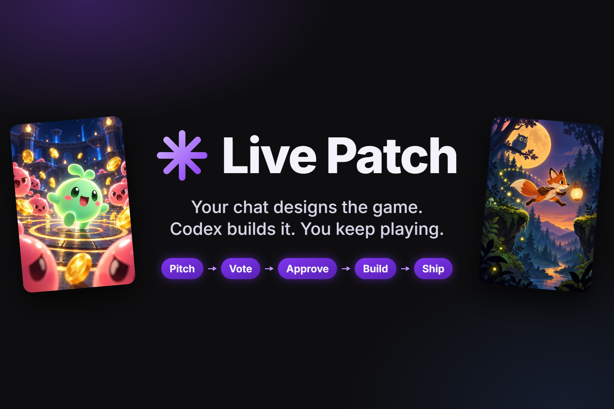

Live Patch turns a Twitch stream into a live game studio: chat designs the game, Codex builds it, and you keep playing.

## 02 — Same game, before and after chat

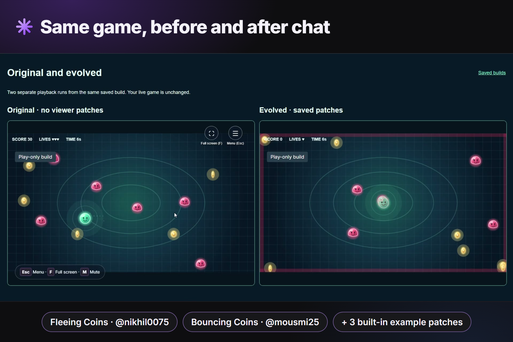

One saved build, side by side: the original game, and the version changed by patches pitched in Twitch chat.

## 03 — Viewers pitch from their phones

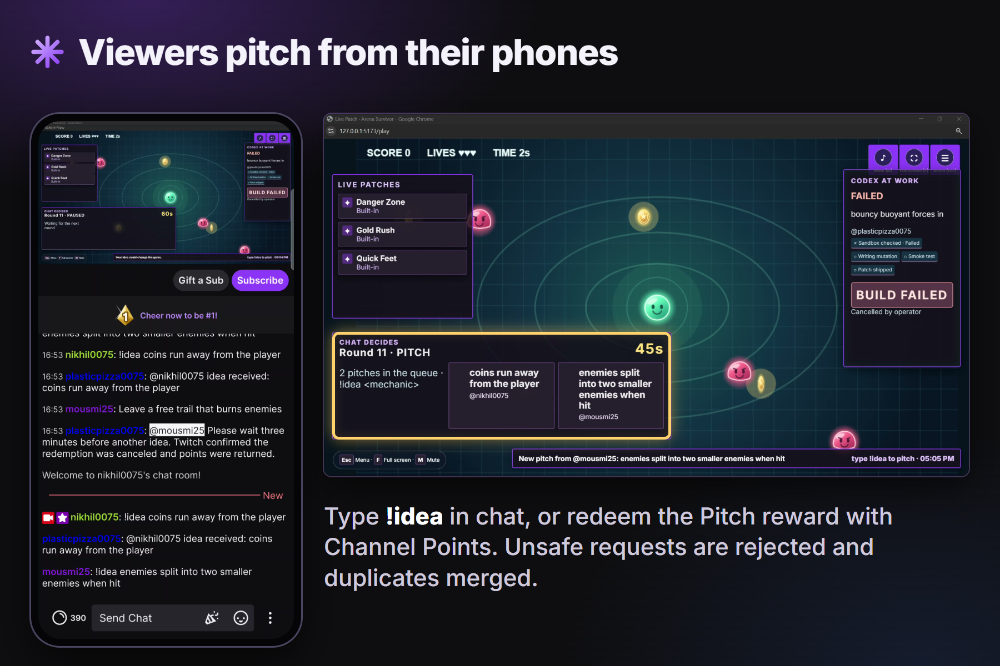

A real viewer pitches a mechanic with !idea or the Pitch channel-points reward, and it appears on the stream overlay.

## 04 — Chat votes, live on the overlay

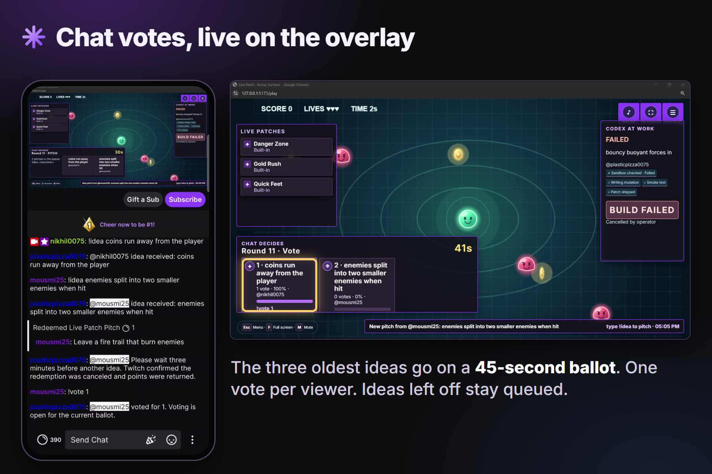

The three oldest ideas go on a 45-second ballot. Votes typed in chat move the bars on the overlay.

## 05 — A moderator approves the winner

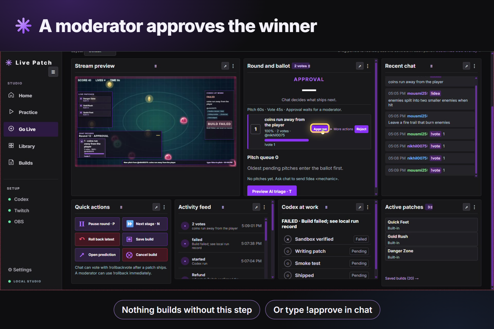

Nothing builds until a moderator approves the winner, from the Go Live dashboard or with !approve in chat.

## 06 — Codex builds while the game keeps running

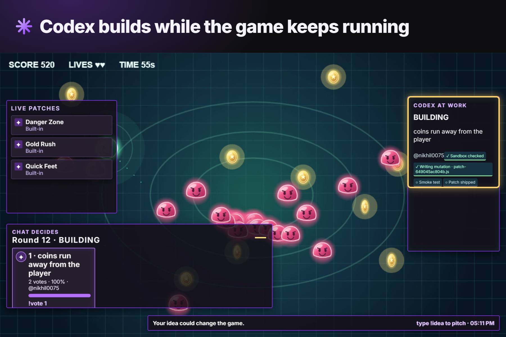

Codex writes the patch in its own offline Git worktree. The stream shows each step while the game keeps running.

## 07 — Viewers can bet on whether it ships

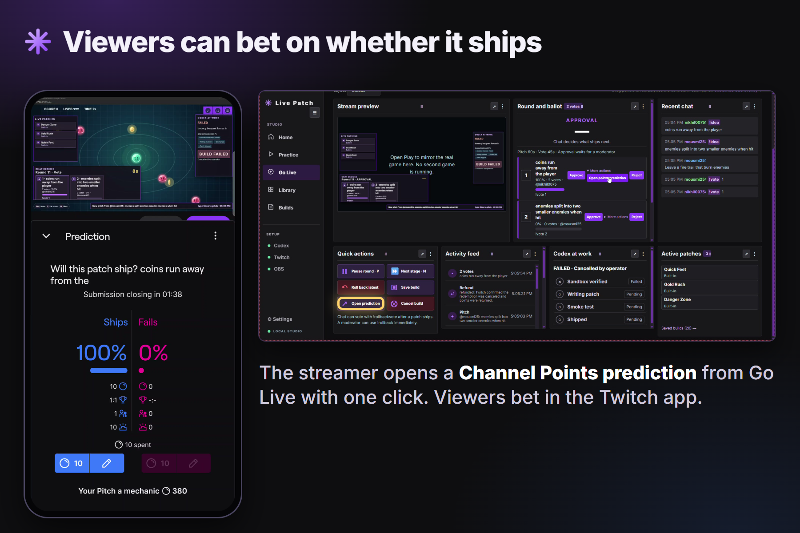

The streamer can open a Channel Points prediction, and viewers bet from the Twitch app on whether the patch ships.

## 08 — Shipped, and credited to the viewer

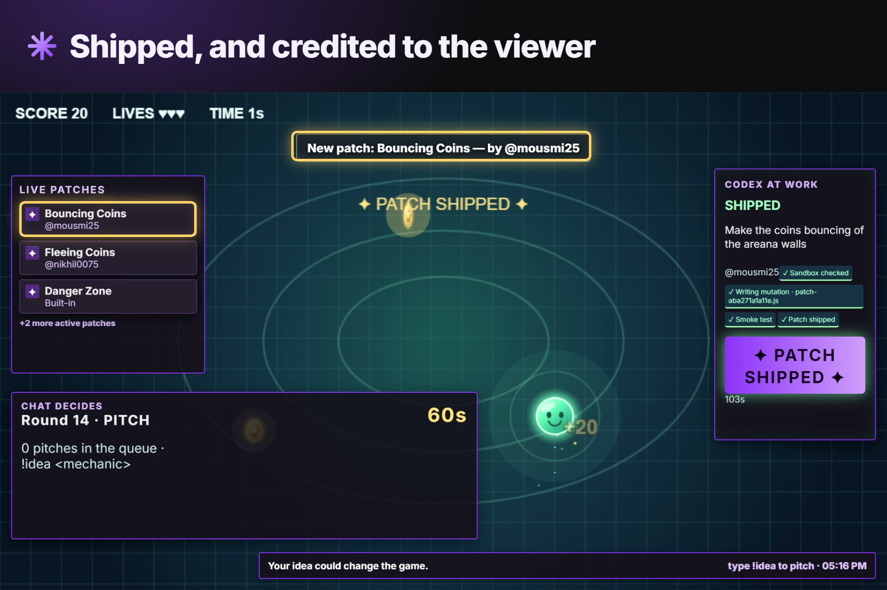

A shipped patch is credited on stream to the viewer who pitched it, in the toast and the Live Patches list.

## 09 — Chat's ideas stack up

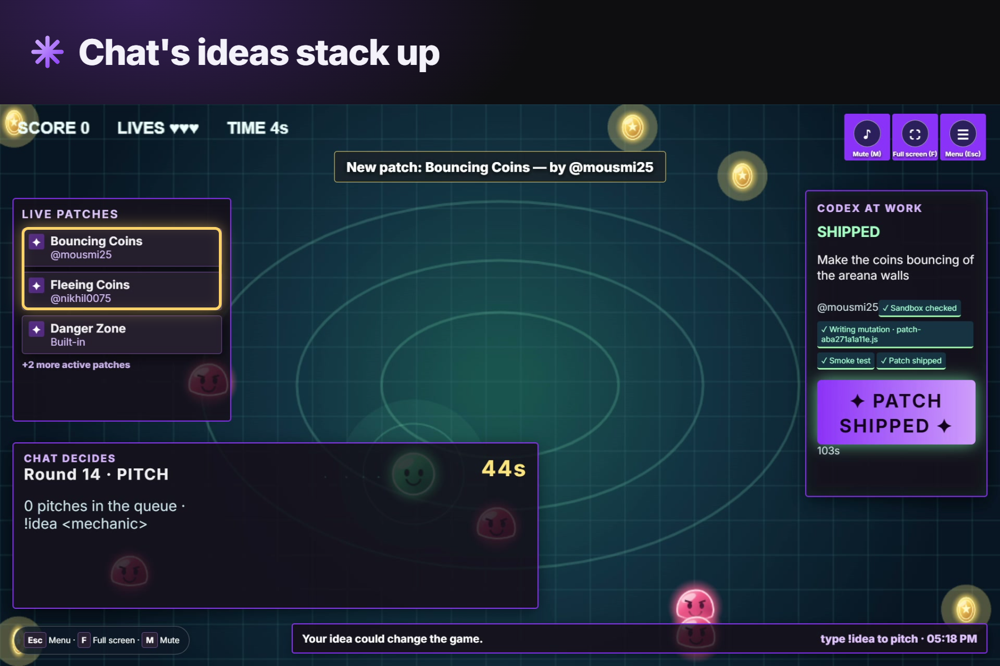

Patches stack: Fleeing Coins and Bouncing Coins, both pitched in chat, running together in one game.

## 10 — One command takes it back

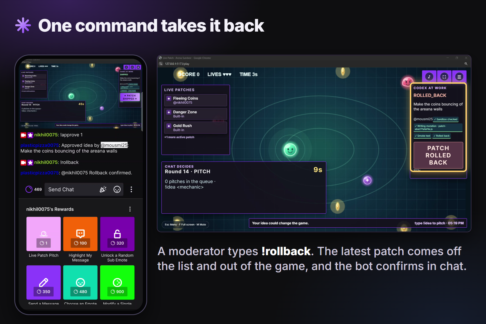

A moderator types !rollback and the latest patch comes out of the game, with confirmation in chat and on the overlay.

## 11 — A failed build never touches the game

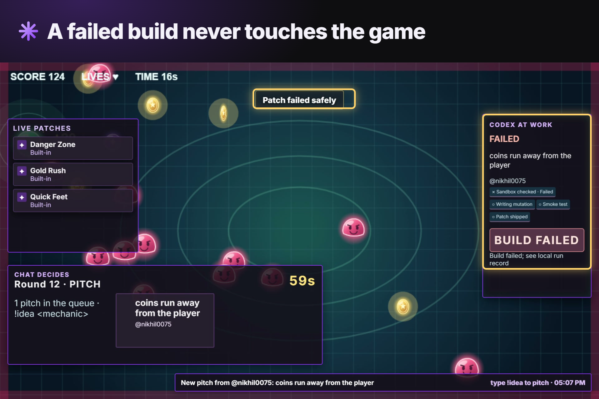

This stream's first build stopped at the sandbox check. Nothing shipped, the game kept running, and bets were refunded.

## 12 — A platform, not one game

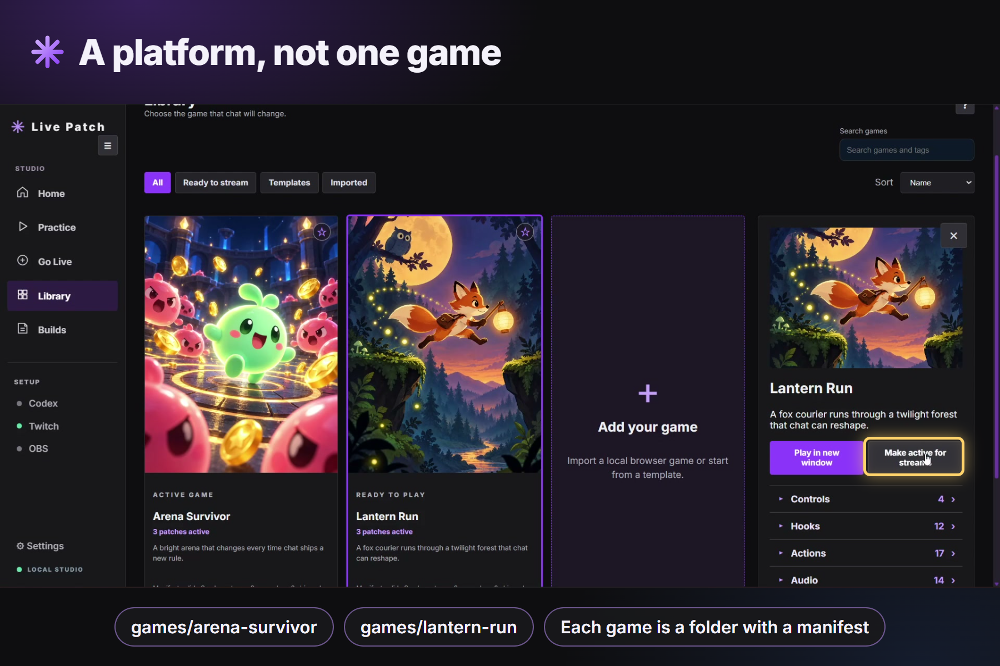

Each game is a folder with a manifest. Choose the active game in the Library, and the same pipeline patches it.

## 13 — Lantern Run: a second game, same engine

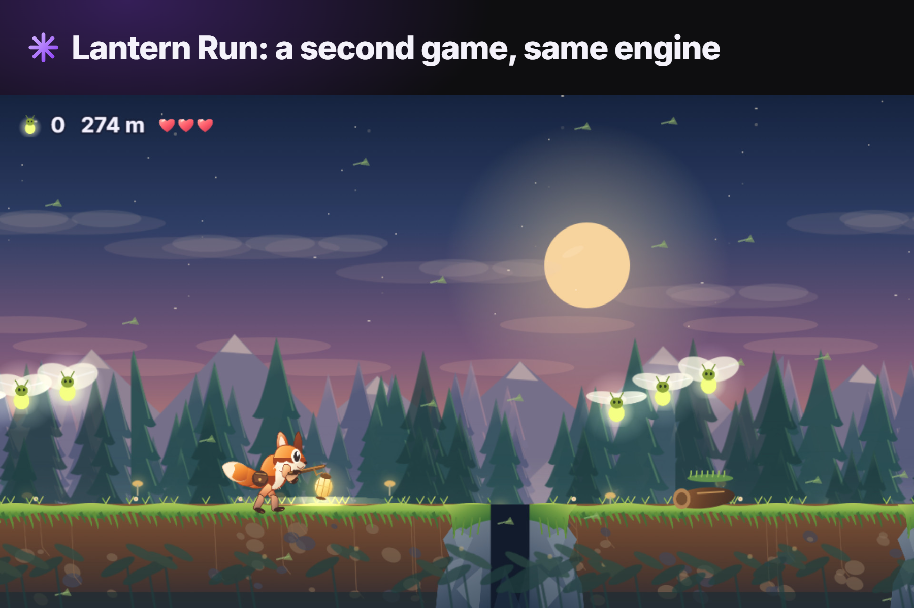

Lantern Run, a one-button fox runner, is the second game on the same engine, with its own hooks and actions.

## 14 — How it works: one clockwise loop

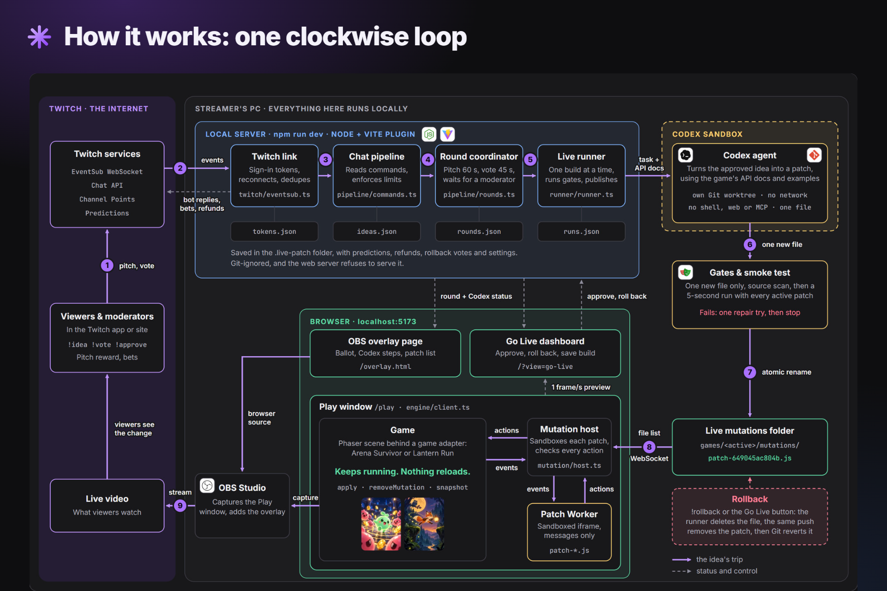

The full loop: Twitch chat, local server, sandboxed Codex build, gates and smoke test, then into the running game.

## 15 — Built with Codex, phase by phase

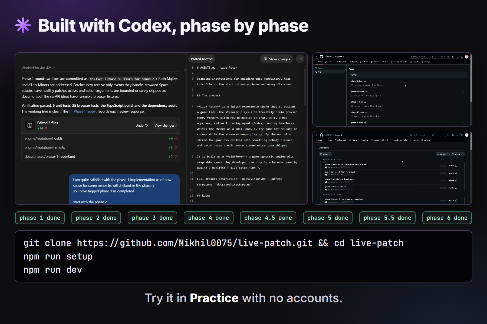

Codex built the engine, both games and the tests in reviewed phases. Clone the repo and try Practice with no accounts.

[Back to the README](../README.md)
